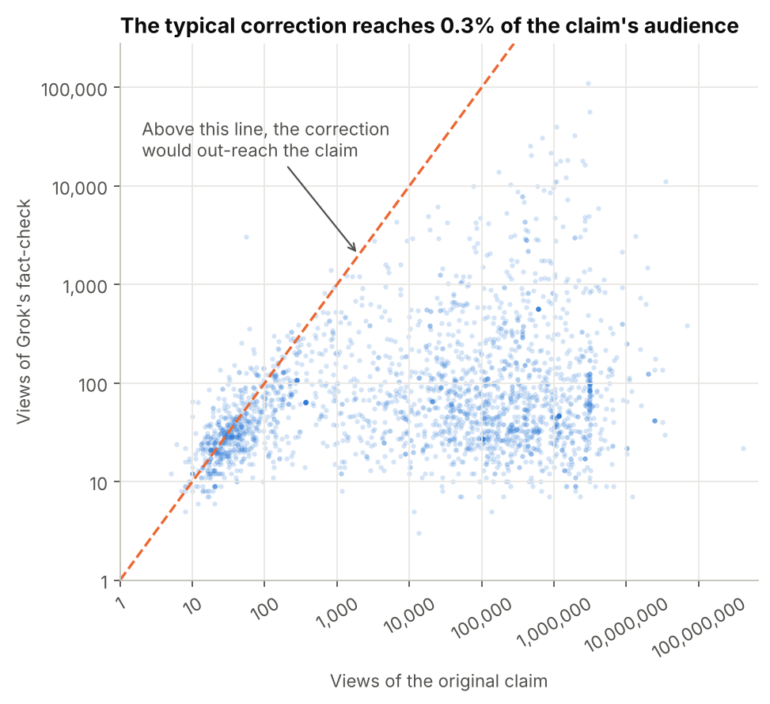
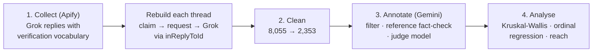
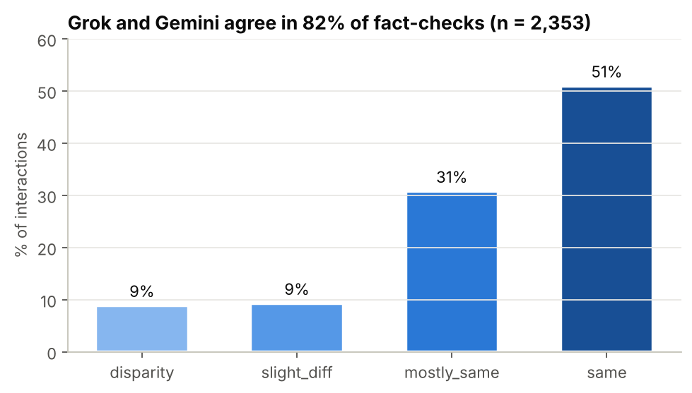
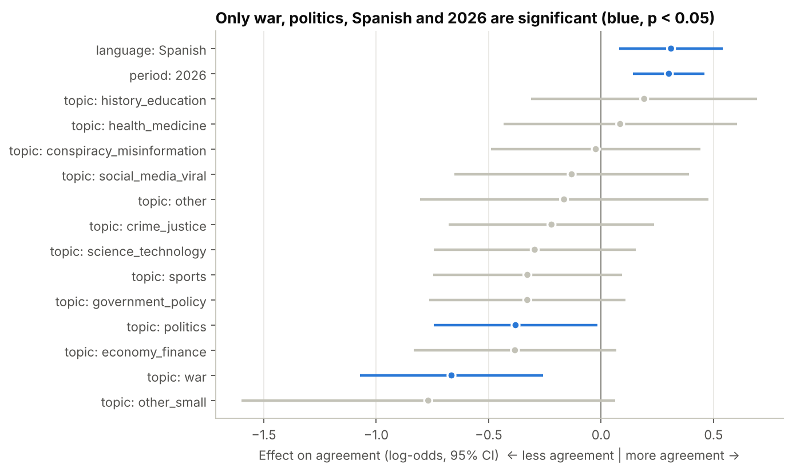

# True but invisible: Grok as a fact-checker on X

**Does an AI fact-checker get it right, and does its correction actually reach anyone?**

I built a dataset of 2,353 real interactions where X users asked Grok to fact-check a post (*"@grok is this true?"*). Each of Grok's verdicts was compared against an independent model (Gemini), and I measured how much of the original audience each correction reached.

[Versión en español](README.es.md) · [Paper (ES, 5 pages)](paper/true_but_invisible_paper_ES.pdf) · Master's thesis, Data Analytics for Business, UPF Barcelona School of Management (2026)



## Key findings

| | Finding |
|---|---|
| **Agreement** | Grok and Gemini reach the same or mostly the same verdict in **82%** of cases (χ² = 1,145.9 vs. uniform, p < 0.001). |
| **Where they disagree** | Once everything else is controlled for, disagreement concentrates on **war** (−0.67 log-odds) and **politics** (−0.38). Language and period effects are significant but small. |
| **Reach** | The median Grok fact-check reaches **0.3%** of the audience of the post it corrects. Only **1 in 10** gets more views than the original. |

**So what?** The bottleneck of automated fact-checking on social media is not the quality of the verdict but its distribution. Better accuracy alone won't help much if the correction stays invisible. That puts platform design, meaning how and where corrections are shown, at the centre of the problem.

## How it works



1. **Collection.** An Apify scraper searched Grok's replies for verification vocabulary (43 keywords in English and Spanish, e.g. *"not true"*, *"according to"*, *"no es cierto"*) in two windows: Mar–Jun 2025 and Feb–May 2026. Two more passes over `inReplyToId` retrieved the user's request and the original claim, rebuilding each three-tweet thread.
2. **Cleaning.** The funnel removed Grok checking its own replies, overly long texts, link-only or incoherent claims, duplicates and claims with nothing to fact-check (flagged by an LLM filter). Cases the judge couldn't classify and minority languages were dropped at analysis time.
3. **Annotation.** For each claim, **Gemini 3.1 Flash Lite** (with Google Search) produced an independent fact-check from the same context Grok had. A *different* model, **Gemini 3.5 Flash**, acted as judge. It rated the agreement on a 4-point ordinal scale, gave its confidence and assigned one of 14 topics. Using a separate judge avoids a model grading its own output.
4. **Analysis.** Kruskal-Wallis with effect sizes (ε²) and Holm correction, Dunn post-hoc tests, an ordinal logistic regression as a robustness check, Cochran-Mantel-Haenszel for language × period, and a *capture ratio* (Grok views ÷ claim views) for reach.

| Cleaning step | n |
|---|---:|
| Grok replies scraped | 8,055 |
| Threads after joining the three downloads | 6,835 |
| After cleaning and the fact-checkability filter | 2,493 |
| **Analysis sample** (judge verdict available, English or Spanish) | **2,353** (2,016 EN · 337 ES · 1,050 from 2025 · 1,303 from 2026) |

## Results





- **The judge is calibrated.** Its confidence rises with agreement (Spearman ρ = 0.66). That means the annotation carries real signal and isn't noise.
- **Topic mix, not the models, drives part of the time effect.** Topic composition differs between periods (Cramér's V = 0.24), so the 2026 increase shouldn't be read as "models got better".
- **Language and period are independent.** The Spanish effect holds within each period (Mantel-Haenszel OR = 0.70, 95% CI 0.50–0.97), and there is no interaction (F = 0.12, p = 0.73).
- **Engagement ≠ agreement.** The most-viewed topics (celebrities, sports) are not the most disputed ones (war, politics). For Grok's replies, likes, retweets and bookmarks are zero more than 99% of the time, so reach is measured with views.

## Validation

- **Qualitative review of 80 disagreements.** The team manually coded 80 cases where the two models disagreed. Grok was judged more accurate in 37 and Gemini in 22. About a third of the disagreements were **temporal**: Gemini's knowledge cutoff missed events Grok could see on X, such as the India–Pakistan ceasefire and PSG's Champions League win. Coding without tweet text: [`data/qualitative_coding.csv`](data/qualitative_coding.csv).
- **LIAR benchmark.** As a sanity check of the setup, Gemini reached 30.2% six-class accuracy on the LIAR test set, above the original text-only baselines (CNN 27.0%). See the [notebook](notebooks/01_judge_validation_liar.ipynb) for the caveats on how this run was configured.

## Limitations

- It measures **consistency between models, not accuracy** against human ground truth.
- The sample is skewed towards English (86%).
- View counts are a snapshot taken at scraping time. The audience before and after Grok's reply can't be separated.

## Repository

```
├── data/
│   ├── annotations.csv          # 2,493 threads: tweet IDs, view counts, LLM labels (no tweet text)
│   ├── qualitative_coding.csv   # manual coding of 80 disagreements
│   └── README.md                # data dictionary and how to rehydrate tweets
├── notebooks/
│   ├── 01_judge_validation_liar.ipynb
│   └── 02_analysis.ipynb        # every number and figure in this README
├── src/
│   ├── factcheck/               # collect.py · clean.py · annotate.py · config.py (prompts, keywords)
│   └── run_pipeline.py          # rebuild the dataset from scratch (needs API keys)
├── tests/                       # offline tests, API clients are mocked
├── figures/
└── paper/
```

**Reproduce the analysis** (no API keys needed):

```bash
pip install -r requirements.txt
jupyter lab notebooks/02_analysis.ipynb
pytest tests
```

**Rebuild the dataset** (needs `APIFY_TOKEN` and `GEMINI_API_KEY`, see `.env.example`): `python src/run_pipeline.py collect | clean | annotate`. The annotation step saves checkpoints and resumes where it stopped. Because X content changes over time, a fresh run won't match the published sample exactly.

## Team and my role

Group thesis by Diego Gamarra, Antoni Homet, **Pablo Gálvez** and Chonghe Huang, supervised by Jorge Saldivar.

**My contribution:** I co-led the technical work end to end with Antoni Homet: data collection with Apify and thread reconstruction, the cleaning funnel, the Gemini annotation pipeline and the statistical analysis.

For this portfolio version I refactored the original Colab notebooks into a tested Python package. The duplicated per-batch cells became one resumable runner, and the prompts and parameters now live in a single config file. I also rewrote the analysis notebook so it runs end-to-end on a text-free dataset. The statistical results are unchanged from the published study.

## Data and ethics

Only tweet IDs, public view counts and the model-generated labels are published. Tweet text and author information are not redistributed. Anyone with X access can rehydrate the tweets from their IDs; see [`data/README.md`](data/README.md).
